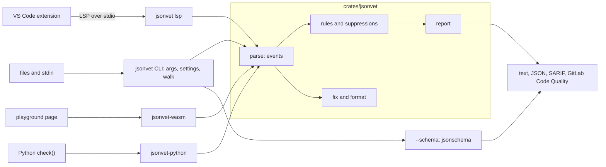

# jsonvet architecture

Follow a check from the CLI, editor, playground or Python through the parser to its diagnostics.
See the [design](design.md) and [decisions](decisions/README.md) for why each part works this way.

Last reviewed 2026-11-28.

## How a check runs

The library in `crates/jsonvet/` parses text in one pass and returns a report of problems with
their positions. It works in memory. The command line and language server in `crates/jsonvet-cli/`,
the playground's WebAssembly build and the [Python bindings](../crates/jsonvet-python/README.md)
all use the library. The hook and GitHub Action install the CLI wheel.



1. `settings.rs` in the CLI picks each file's dialect and rule severities from the nearest config
   file, and `glob.rs` matches the file patterns.
2. `parse.rs` in the library reads the bytes once into events, with a stack of open containers
   instead of recursion. The rules and the inline suppressions run on those events, and the
   report holds the problems by byte offset.
3. With `--schema`, the CLI folds the same events into the values jsonschema checks
   (`crates/jsonvet-cli/src/schema/`), and places each schema error back at its key or value.
4. The CLI turns byte offsets into lines and columns and writes its report as text, JSON, SARIF
   or GitLab Code Quality. `--fix` and `jsonvet fmt` write the result through `write.rs`, which
   replaces a file safely.

## The parts

```text
crates/jsonvet/        library: the parser, rules and positions. Depends on hashbrown, memchr and
                       unicode-properties.
crates/jsonvet-cli/    jsonvet CLI: arguments, config, output, --schema
                       (jsonschema, serde_json) and the language server, `jsonvet lsp`
                       (lsp-server). Built into the PyPI wheels by maturin.
crates/jsonvet-wasm/   the library as WebAssembly for the playground: `check`, `fix`, `format` and `version`
crates/jsonvet-python/ Python bindings for in-memory checks, built from their own Cargo workspace
editors/vscode/        the VS Code extension: a thin client for `jsonvet lsp`, in TypeScript
playground/            the browser playground: a static page around the wasm. Deployed by pages.yml.
setup.py               placeholder that pre-commit installs: pins the jsonvet wheel
action.yml             the GitHub Action: installs the jsonvet wheel from PyPI and runs it
fuzz/  tests/  scripts/
```

### The library interface

The public API is `check`, `Config`, `Dialect`, `UnknownDialect`, `Rule`, `Severity`, `UnknownRule`,
`Location`, `Report`, `Problem`, `Related` and `RelatedKind` ([docs.rs](https://docs.rs/jsonvet)).
Each type is `#[non_exhaustive]` or has private fields, so a new variant or field is not a breaking
change. The `#[doc(hidden)]` items serve jsonvet's own crates and can change in any release:
`parse`, `parse_with`, `parse_lines`, `join_lines`, `line_parts`, `Lines`, `Event`, `EventKind`,
`json_path`, `PathStep`, `key_text`, `did_you_mean`, `closest`, `MESSAGES`, `fill`,
`Problem::message_with`, `is_hidden`, `Fix`, `Fixed`, `try_fix`, `report`, `format`, `FormatError`,
`FormatOptions` and `Indent`.

`format` is the formatter behind `jsonvet fmt`. It checks the text first and returns the report if
there is a syntax error. Then it reads its own token stream, so the check path is unchanged: it
attaches each comment to the token it sits next to, and lays the tree out from the tree alone, so
a second run changes nothing. The tree is flat vectors of 16-byte records with 32-bit offsets into
the text, a first pass counts the output so it is built once at its size, and a file whose output
would pass 16 times its size is refused. It recurses once per nesting level, which `max_depth`
bounds.

The text is `&str`, so every offset falls on a character boundary. `check` never panics and has no
error mode: the problems in the file are its output. A `Report` is `Send` but not `Sync`, because
`location` caches line starts inside it.

The parser keeps an explicit stack of frames, not recursion, so the depth limit is a setting and
not the call stack's size. Past 32 keys, an object's keys go through a hash index keyed with std's
SipHash from the OS, so a crafted file cannot make the check quadratic
([0003](decisions/0003-siphash-for-duplicate-keys.md)). There is no `unsafe` code, so the worst a
crafted file can do is a panic ([0002](decisions/0002-no-unsafe-code.md)).

### Python packaging

pre-commit installs a `language: python` hook with `pip install .`. The root `setup.py` is a
placeholder that depends on the exact released `jsonvet` wheel, so a hook install downloads a
binary and never compiles Rust ([0008](decisions/0008-binary-wheels-behind-a-placeholder.md)).
maturin builds the wheels with `bindings = "bin"`, for Linux (glibc 2.28 or newer, and musl),
macOS and Windows, each on x86-64 and arm64.
